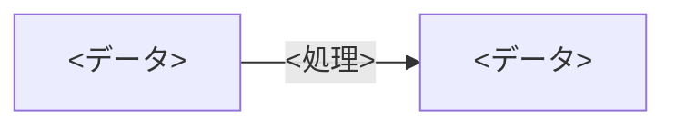

# Slide Project Instructions

このプロジェクトは、Qiitaのスライドモードで投稿する技術記事（Markdown）を管理する。
ソフトウェア開発プロジェクトではないため、親ディレクトリの `../CLAUDE.md` の指示は以下のとおり読み替える。

## `../CLAUDE.md` からの適用範囲

| 親の指示                                           | このプロジェクトでの扱い                                     |
| -------------------------------------------------- | ------------------------------------------------------------ |
| Language（日本語で応答・記述）                     | **適用する**                                                 |
| セキュリティ                                       | 下記「セキュリティ・情報の扱い」に置き換える                 |
| 開発プロセス（仕様駆動開発・`docs/` 配下の仕様書） | **適用しない**。`docs/steering/`・`docs/specs/` は作成しない |
| ログ出力                                           | **適用しない**                                               |
| 例外処理                                           | **適用しない**                                               |
| テスト自動化                                       | **適用しない**。代わりに下記「レビュー観点」で記事を確認する |

- 記事の構成やテーマが曖昧な場合は、執筆前にユーザーへ確認すること

## ディレクトリ構成

```
slide/
├── CLAUDE.md
└── <記事タイトル>.md   # 1記事 = 1ファイル。ファイル名は記事タイトル（日本語可）
```

- 画像等を追加する場合は、ユーザーに配置方法を確認すること（Qiitaは画像を記事内に直接アップロードする運用のため）

## スライドモードの記法

- スライドは `---` で区切る。**1スライドはスライド1ページに収まる分量**とする
  - 目安：本文20行程度、表は6行程度まで。収まらない場合は `3-1.` `3-2.` のようにスライドを分割する
- `---` の前後には必ず空行を入れる（直前に空行がないと、前の行が見出しとして解釈されるため）
- スライド内で `---` を水平線として使わない

## 記事の構成

すべての記事を以下の構成で統一する。

1. **タイトルスライド**：`# タイトル` と、所要時間・キーワードの箇条書き
2. **アジェンダ**：`# 今日のアジェンダ` に章の番号付きリスト
3. **本編**：章は `# N. 章タイトル`、節は `## N-M. 節タイトル`
4. **まとめ**：`# まとめ` に要点を番号付きリストで整理し、最後に引用（`>`）で一言のメッセージ
5. **参考資料**：`# 参考資料` に出典URLを列挙（出典がある場合）

### テンプレート

````markdown
# <記事タイトル>

- 所要時間：約N分
- キーワード：<キーワード1> / <キーワード2> / ...

---

# 今日のアジェンダ

1. <章タイトル>
2. <章タイトル>
3. まとめ

---

# 1. <章タイトル>

**<このスライドの要点を一文で>**

- <説明>

| 項目 | 説明 |
| ---- | ---- |
| ...  | ...  |

---

## 2-1. <節タイトル>

**<このスライドの要点を一文で>**



- ○ <良い点・推奨>
- × <悪い点・非推奨>

---

# まとめ

1. <要点>
2. <要点>

> <最も伝えたい一言>

---

# 参考資料

- [<資料名>](URL)
````

## 文体・表現

- 本文は「である」調で記述する
- 各スライドの冒頭に、そのスライドの要点を**太字**の一文で示す
- 比較・用語整理は表で表す
- 良い例・悪い例は ○ / ×、非推奨・注意は △ を用いる（絵文字は使わない）
- 強調したい教訓は引用（`>`）で示す
- 処理の流れは Mermaid（` ```mermaid `）の flowchart で表す
  - データは箱（ノード）、処理は矢印のラベルで表す
  - 原則は横向き（`flowchart LR`）とし、横向きで文字が小さくなる場合は縦向き（`flowchart TB`）にする
  - 1つの図は箱4個程度まで、箱・矢印の文字は12文字程度までを目安とする
  - それでも1枚に収まらない場合は、文字を短くするか、スライドを分割する
- 矢印は本文・表・図のすべてで `->` に統一する（`→` `──▶` `↓` などは使わない）。ただし、Mermaid のコードブロック内は Mermaid の記法に従う

## 正確性

- 技術的な記述は、断定しすぎず正確性を優先する（例外や前提条件がある場合は明記する）
- 推奨・非推奨のアルゴリズムや仕様など、時期によって変わる情報は最新の情報で確認する
- 実際の事件・事例を扱う場合は、公表日と「公表時点の情報である」旨を明記し、出典を参考資料に記載する
- 公表資料から読み取れないこと（原因・判断理由など）を推測で断定しない

## セキュリティ・情報の扱い

- 認証情報（APIキー、パスワード、トークン等）や、実在する秘密鍵・JWTなどを記事に含めない。例示には明らかなダミー値を使う
- 個人情報や社内の非公開情報を記事に含めない
- 実在の企業・事例を扱う場合、本文では社名を伏せる（事例A・事例Bなど）
- 攻撃手法を扱う場合は、仕組みの理解と防御策の説明にとどめ、悪用可能な具体的手順は記載しない

## レビュー観点

記事の作成・修正後は、以下を確認する。

- すべてのスライドが1ページに収まる分量か
- `---` の前後に空行があるか
- アジェンダ・章番号・まとめの内容が本編と一致しているか
- 誤字脱字・用語の誤用がないか
- 表のMarkdownが崩れていないか
- 参考資料のURLと本文の記述が対応しているか
